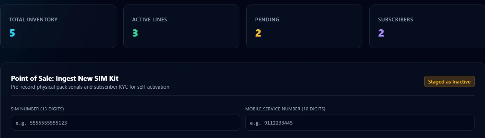
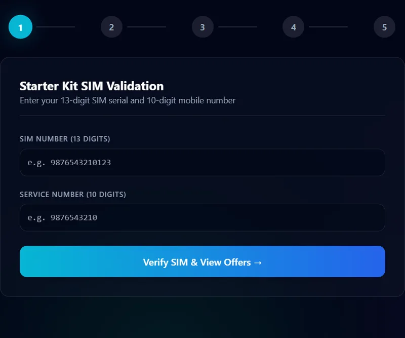
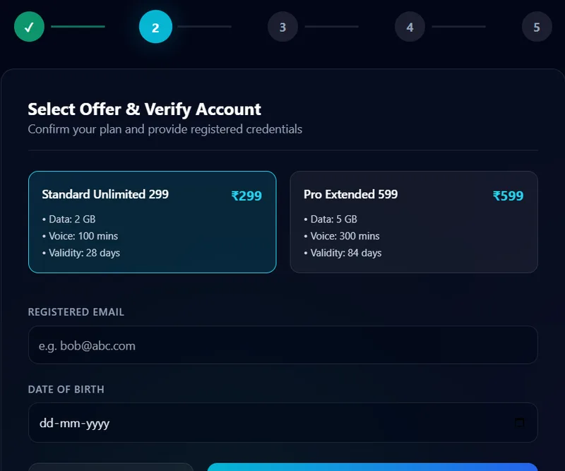

# SIM Activation Portal


A self-service portal where customers **activate their own SIM card**: validate the SIM, choose an offer, confirm their account details and submit an ID proof. An admin console lets staff register new SIM kits and watch inventory, active lines and pending activations.

<p align="center">
  
</p>
<p align="center">
  
  
</p>

## Features

**Customer flow**

1. **Validate the SIM** with the 13-digit SIM number and the 10-digit service number.
2. **Pick an offer** from the plans available for that SIM and confirm the registered email and date of birth.
3. **Verify personal details.**
4. **Update the address.**
5. **Validate the ID proof** (12-digit Aadhaar or 16-digit ID) to activate the SIM.

**Admin console**

- Dashboard metrics: total inventory, active lines, pending activations and subscribers.
- Lists of all SIMs and customers.
- Onboard a new SIM kit (point-of-sale entry).
- Change a SIM's status.
- Token-protected endpoints.

## Tech stack

| Layer | Technology |
| --- | --- |
| Backend | Java 21, Spring Boot 3.3.4, Spring Web, Spring Data JPA, Bean Validation |
| Database | MySQL (schema `SimPortal`, tables generated by Hibernate) |
| Frontend | React 19, Vite, Tailwind CSS |
| Testing | REST endpoints exercised with SoapUI / Postman |

## Project structure

```
sim-validation/
├── sim-portal-project/            # Spring Boot backend (port 8085)
│   └── src/main/java/com/simportal/
│       ├── controller/            # SimController, CustomerController, AdminController
│       ├── service/               # business logic and validation rules
│       ├── repository/            # Spring Data JPA repositories
│       ├── entity/                # Customer, CustomerAddress, CustomerIdentity,
│       │                          # SimDetails, SimOffers
│       ├── dto/                   # request and response objects
│       └── exception/             # global error handling
└── sim-portal-ui/                 # React + Vite frontend
    └── src/App.jsx                # customer stepper and admin console
```

## Getting started

### Prerequisites

- JDK 21
- Maven (or use your IDE's Maven support)
- MySQL 8
- Node.js 18 or newer

### 1. Database

```sql
CREATE DATABASE SimPortal;
```

Hibernate creates and updates the tables automatically (`ddl-auto=update`).

### 2. Backend

Edit `sim-portal-project/src/main/resources/application.properties` with your own MySQL username and password:

```properties
spring.datasource.url=jdbc:mysql://localhost:3306/SimPortal?useSSL=false&allowPublicKeyRetrieval=true
spring.datasource.username=<your_user>
spring.datasource.password=<your_password>
server.port=8085
```

Then run:

```bash
cd sim-portal-project
mvn spring-boot:run
```

The API is now at `http://localhost:8085/api`.

### 3. Frontend

```bash
cd sim-portal-ui
npm install
npm run dev
```

Open the address Vite prints, usually `http://localhost:5173`. The frontend expects the API at `http://localhost:8085/api` (see `API_BASE` in `src/App.jsx`).

## API overview

| Method | Endpoint | Purpose |
| --- | --- | --- |
| POST | `/api/sim/validate` | Validate SIM and service number, return offers |
| POST | `/api/customer/validate-basics` | Check email and date of birth |
| POST | `/api/customer/validate-personal` | Check personal details |
| PUT | `/api/customer/address` | Update the address |
| POST | `/api/customer/validate-id` | Validate the ID proof and activate the SIM |
| GET | `/api/admin/metrics` | Dashboard counts (admin token) |
| GET | `/api/admin/sims`, `/api/admin/customers` | Inventory and customers (admin token) |
| POST | `/api/admin/onboard-sim` | Register a new SIM kit (admin token) |

## Roadmap

- Replace the fixed admin token with real authentication (JWT).
- Move database credentials to environment variables.
- Add automated tests for the validation rules.

## Author

**Shahith S**, final-year CSE student at University College of Engineering, Nagercoil
[GitHub](https://github.com/Shahith645) · [LinkedIn](https://www.linkedin.com/in/shahith-s/)
